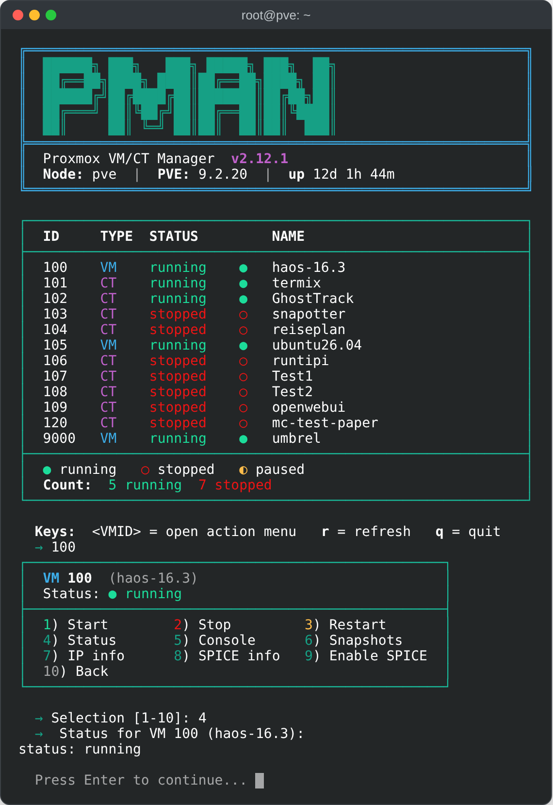
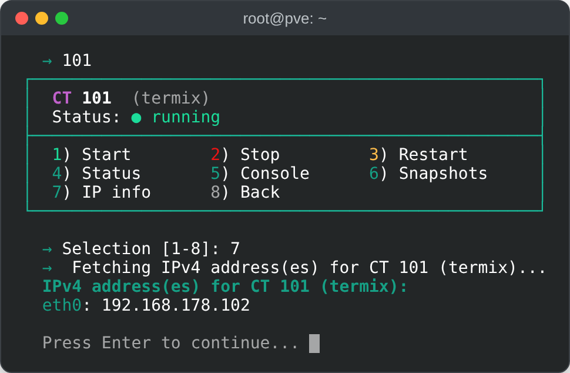
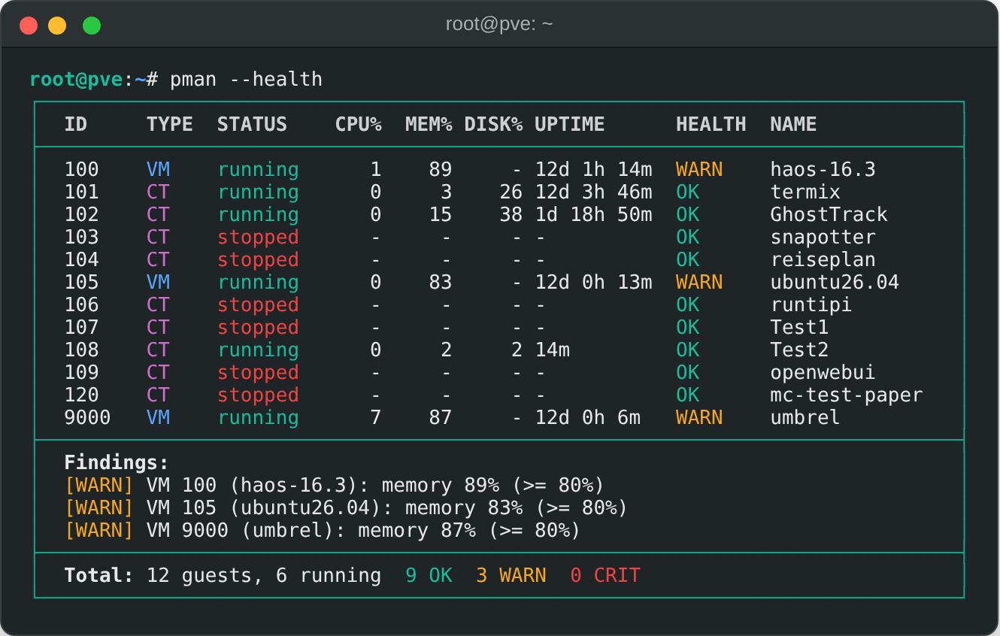
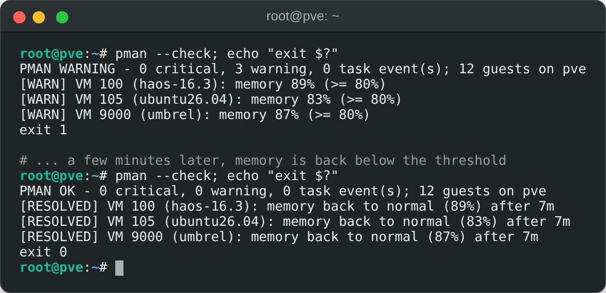
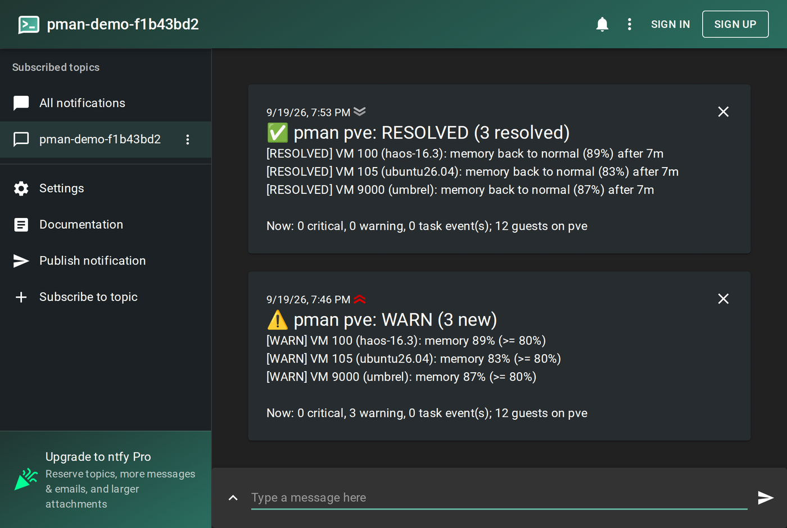
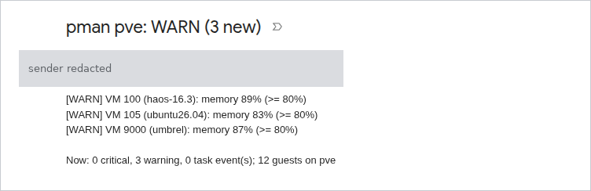
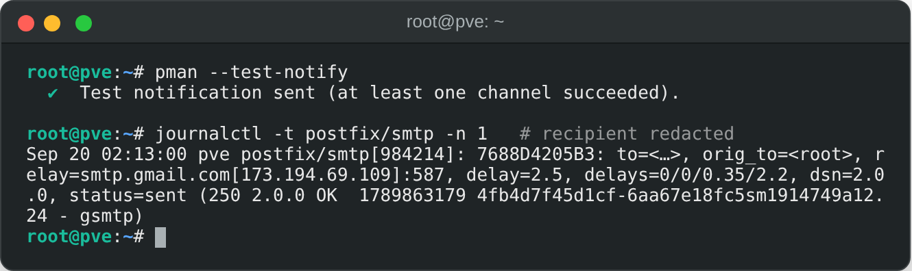
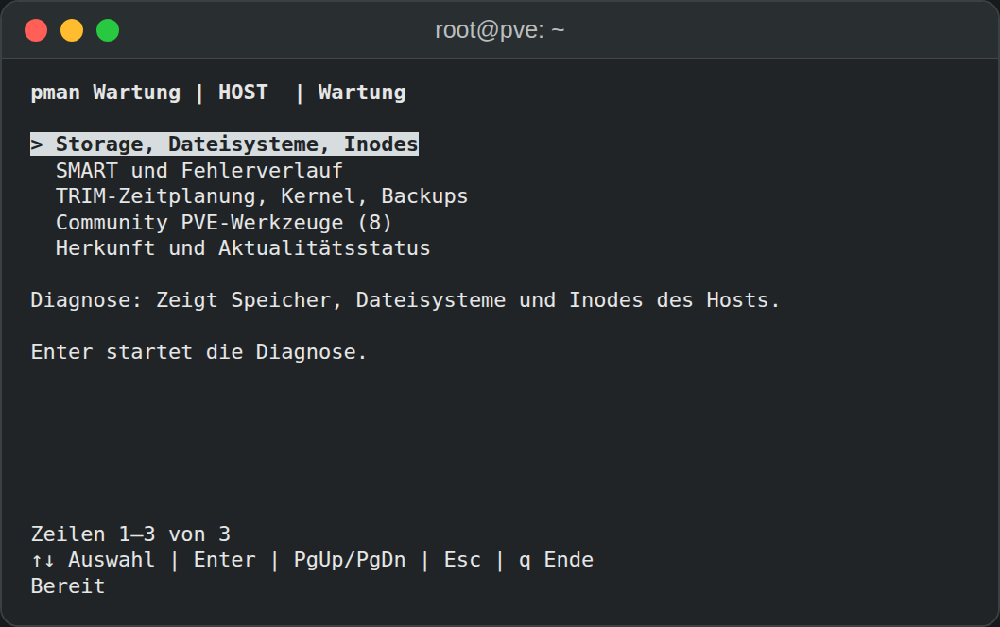

# Proxmox Manager

Virtuelle Maschinen und LXC-Container auf Proxmox VE im Terminal verwalten.

Proxmox Manager (`pman`) bietet interaktive Gastverwaltung, skriptfähige
Inventarausgaben und Zustandsprüfungen auf dem lokalen Proxmox-Knoten. Der
Bash-Kern nutzt die mit Proxmox VE gelieferten Werkzeuge und läuft bei Bedarf.
Ein optionales Python-Modul ergänzt Speicherdiagnosen und Host-Wartung.

[](https://github.com/TimInTech/proxmox-manager/actions/workflows/ci.yml)
[](https://github.com/TimInTech/proxmox-manager/actions/workflows/gitleaks.yml)
[](LICENSE)

[English](README.md) · Deutsch


Lesende Aufzeichnung: Inventar, Zustandsübersicht, Host-Wartung und die
Bestätigung eines Community-Skripts mit Quellcode-Vorschau. Es werden keine
Wartungsänderungen ausgeführt.
[Lokaler interaktiver Player](docs/demo/index.html) ·
[Details zur Aufzeichnung](docs/demo/README.md). Den Player aus einem lokalen
Checkout als HTML-Datei öffnen; GitHub zeigt den Quelltext an.

[Installation](#installation) · [Nutzung](#nutzung) ·
[Zustandsprüfung & Alarme](#zustandsprüfung--alarme) ·
[Konfiguration](#konfiguration) · [Wartung](#optionale-wartung)

## Funktionen

- **Gastverwaltung.** VMs und Container auflisten, starten, herunterfahren und
  neu starten; Konsolen öffnen, IPv4-Adressen abfragen und Snapshots verwalten.
- **Zustandsprüfung.** CPU, Arbeitsspeicher, Speicherplatz und Laufzeit je Gast
  mit einstellbaren Schwellenwerten und Alarmen über ntfy oder E-Mail.
- **Automatisierung.** Inventar als Klartext oder JSON, Status- und Namensfilter,
  Nagios-kompatible Exit-Codes und optionale strukturierte Protokolle.
- **SPICE-Zugriff.** QXL-Anzeige konfigurieren und authentifizierte
  `.vv`-Verbindungsdateien über den Proxmox-Proxy anfordern.
- **Optionale Wartung.** Speicher-, Dateisystem- und SMART-Diagnosen,
  gastbezogene Wartung und ausgewählte Proxmox VE Helper-Scripts der Community.

## Installation

Als **root auf dem Proxmox-VE-Knoten** ausführen. Das Projekt richtet sich an
PVE 7.x, 8.x und 9.x. Der Kern benötigt Bash 4 oder neuer, `qm`, `pct`, `pvesh`
und Python 3; diese gehören zu PVE. Für das Klonen wird zusätzlich Git benötigt.

```bash
git clone https://github.com/TimInTech/proxmox-manager.git
cd proxmox-manager
./install_dependencies.sh --without-maintenance
pman
```

Der Installer legt atomar eine root-eigene Kopie unter `/usr/local/bin/pman`
ab. Spätere Änderungen am Checkout verändern das installierte Programm nicht.
Er installiert keine APT-Pakete, optionalen Anzeigeprogramme oder
Entwicklungswerkzeuge.

Der Kern lässt sich auch direkt aus dem Checkout starten:

```bash
bash proxmox-manager.sh
```

### Wartungsmodul hinzufügen

Das Modul benötigt Python 3.9 oder neuer mit `curses` und ein UTF-8-Terminal.
Es verwendet ausschließlich die Python-Standardbibliothek.

```bash
./install_dependencies.sh --with-maintenance --lang de
pman --maintenance
```

Ohne `--with-maintenance` oder `--without-maintenance` fragt der Installer im
interaktiven Terminal nach; ohne Terminal installiert er nur den Kern.
Die Wartungsoberfläche unterstützt Deutsch (Standard) und Englisch. Wenn keiner
der beiden Modulparameter übergeben wird, fragt der Installer bei der ersten
interaktiven Installation auch nach der Sprache.
`--lang de|en` legt sie ausdrücklich in `/etc/pman/language` fest; Updates
erhalten diese Wahl. `PMAN_LANG=de pman --maintenance` überschreibt sie für
einen Aufruf.

Die Modulinstallation aktiviert normalerweise einen täglichen systemd-Timer,
der öffentliche Quellenmetadaten prüft. Mit `--no-source-timer` wird er nicht
aktiviert. Ein bereits aktiver Timer lässt sich so abschalten:

```bash
systemctl disable --now pman-maintenance-sources.timer
```

Bedienung, Quellenprüfung, Rollback und Deinstallation sind unter
[optionale Wartung](#optionale-wartung) beschrieben.

## Nutzung

### Interaktive Verwaltung

`pman` starten und die VMID eines Gastes eingeben, um dessen Aktionsmenü zu
öffnen. `h` zeigt die Zustandsübersicht, `r` aktualisiert und `q` beendet die
Ansicht. `M` oder `m` öffnet die optionale Wartung: im Hauptmenü für den Host,
im Aktionsmenü für den ausgewählten Gast.

```text
[+] running   [-] stopped   [~] paused   [?] unknown
```

| Gastinventar | Gastaktionen |
| --- | --- |
|  |  |

Die Screenshots zeigen Beispielansichten. Versionsangaben und Ausgaben können
vom aktuellen Checkout abweichen.

Stop fordert ein geordnetes Herunterfahren über `qm shutdown` oder
`pct shutdown` an.
Erst nach Ablauf des eingestellten Zeitlimits (standardmäßig 60 Sekunden)
erzwingt Proxmox den Stopp. Destruktive Kernaktionen verlangen eine Bestätigung;
Fehlermeldungen enthalten Proxmox-Details. Vor Rollback und Löschen wird der
ausgewählte Snapshot angezeigt.

Container-Konsolen verwenden `pct enter`, VM-Konsolen `qm terminal` und eine
eingerichtete serielle Konsole; als Rückfall dient `qm monitor`. Beide benötigen
einen laufenden Gast.
IPv4-Abfragen nutzen `pct exec` bei Containern und den QEMU Guest Agent bei VMs.

### Befehlsreferenz

| Befehl | Zweck |
| --- | --- |
| `pman` | Interaktive Gasttabelle mit Aktionsmenüs öffnen. |
| `pman --list` | Inventar als Klartext ausgeben. |
| `pman --json` | Inventar als JSON-Array ausgeben. |
| `pman --list --filter running` | Nach `running`, `stopped` oder `paused` filtern. |
| `pman --list --name 'web\|db'` | Namen mit einem erweiterten regulären Ausdruck filtern; mit `--filter` kombinierbar. |
| `pman --health` | Zustand lokaler Gäste anzeigen; mit `--list` oder `--json` sowie Namens- und Statusfiltern kombinierbar. |
| `pman --check` | Zustand prüfen und Änderungen melden; Exit-Code `0` OK, `1` WARN, `2` CRIT, `3` UNKNOWN. |
| `pman --check --dry-run` | Ergebnis und vorgesehene Meldung anzeigen, ohne Versand oder Speicherung des Zustands. |
| `pman --test-notify` | Testnachricht über alle eingerichteten Benachrichtigungskanäle senden. |
| `pman --maintenance` | Optionale Host-Wartungsoberfläche öffnen. |
| `pman --timeout 30` | Zeitlimit in Sekunden bis zum erzwungenen Stopp beim Herunterfahren setzen. |
| `pman --force` | Unterstützte Kernbestätigungen überspringen; Wartungsbestätigungen bleiben verpflichtend. |
| `pman --no-clear` | Terminalinhalt zwischen interaktiven Ansichten erhalten. |
| `pman --once` | Einen interaktiven Aktualisierungszyklus ausführen, etwa für Aufzeichnungen. |
| `pman --version` | Version des Kerns ausgeben. |
| `pman --help` | Hilfe anzeigen; `-h` ist gleichbedeutend. |

`--list` und `--json` sind alternative Ausgabeformate. `--check` prüft immer
alle lokalen Gäste und akzeptiert weder Namens- und Statusfilter noch andere
Ausgabeformate. Auch `--maintenance` läuft getrennt von Inventar- und
Zustandsansichten.

### JSON-Inventar

```bash
pman --json
```

Beispielausgabe:

```json
[
  {"id": 100, "type": "VM", "status": "running", "symbol": "[+]", "name": "web-server"},
  {"id": 101, "type": "CT", "status": "stopped", "symbol": "[-]", "name": "db-container"}
]
```

Der eingebaute Filter erhält die Array-Struktur. Für weitere Umwandlungen lässt
sich `jq` separat installieren:

```bash
pman --json --filter running
pman --json | jq '.[] | select(.status == "running")'
```

Fehlschläge bei Inventarabfragen liefern einen Exit-Code ungleich null statt
eines vermeintlich erfolgreichen leeren oder unvollständigen Ergebnisses.

### SPICE-Remotedesktop

**SPICE info** fordert für eine laufende VM mit QXL-Anzeige eine
authentifizierte `.vv`-Verbindungsdatei über die Proxmox-API `spiceproxy` an.
Dazu werden `pvesh` und Python 3 verwendet. Wenn `remote-viewer` installiert ist
und eine grafische Sitzung besteht, startet pman das Programm automatisch.
Unter Debian wird das Paket so installiert:

```bash
apt install virt-viewer
```

Andernfalls gibt pman den Pfad der privaten Verbindungsdatei aus. Diese zeitnah
mit `remote-viewer` auf einem Desktop öffnen, der den Proxmox-Proxy auf TCP 3128
erreichen kann. Die Datei enthält ein kurzlebiges Ticket und
TLS-Vertrauensinformationen; ungenutzte Dateien löschen.
`PROXMOX_MANAGER_SPICE_ADDR` bestimmt den vom Client erreichbaren Hostnamen
oder die IP-Adresse des Proxys, nicht die Bind-Adresse der VM.

**Enable SPICE** setzt den VGA-Typ auf QXL und erhält benannte
VGA-Eigenschaften sowie vorhandene QXL-Mehrmonitor-Einstellungen. Die Änderung
der Anzeigehardware erfordert ein vollständiges Herunterfahren und Starten;
pman startet die VM nicht automatisch neu.

## Zustandsprüfung & Alarme

`pman --health` zeigt CPU, Arbeitsspeicher, Speicherplatz, Laufzeit und
Zustandsstufen der Gäste auf dem **lokalen Knoten**; Templates werden
ausgelassen. `--list` liefert Klartext, `--json` maschinenlesbare Daten mit
`null` für nicht verfügbare Werte. Dieselben Daten erscheinen unter `h` und in
der Statusaktion eines Gastes.



### Benachrichtigungen einrichten

Die folgenden Schritte nach der Installation von `pman` als root ausführen.

1. Mindestens einen Kanal in einer privaten `/etc/pmanrc` einrichten. Den
   Topic-Namen durch einen eigenen, schwer zu erratenden Namen ersetzen: Wer
   den Namen eines öffentlichen ntfy-Topics kennt, kann es lesen. Für
   Zugriffsschutz ein geschütztes Topic mit Token-Datei verwenden; siehe
   [Benachrichtigungskanäle](#benachrichtigungskanäle).

   ```bash
   touch /etc/pmanrc
   chmod 600 /etc/pmanrc
   cat >>/etc/pmanrc <<'EOF'
   NTFY_URL="https://ntfy.sh/pman-alerts-CHANGE-ME"
   # HEALTH_MAIL_TO="admin@example.com"
   EOF
   ```

2. Das Topic in der [ntfy-App](https://ntfy.sh/docs/subscribe/phone/) oder unter
   `https://ntfy.sh/<dein-topic>` abonnieren, anschließend den Versand testen
   und einen Probelauf prüfen. E-Mail erst aktivieren, wenn der Versand über
   das lokale `sendmail` funktioniert. Der Test verwendet alle eingerichteten
   Kanäle und gilt als erfolgreich, sobald mindestens einer funktioniert;
   Fehler einzelner Kanäle werden gemeldet.

   ```bash
   pman --test-notify
   pman --check --dry-run; echo "exit $?"
   ```

3. Alle fünf Minuten prüfen lassen. Cron benötigt einen ausdrücklich gesetzten
   `PATH`, der `/usr/sbin` enthält.

   ```bash
   cat >/etc/cron.d/pman-health <<'EOF'
   PATH=/usr/sbin:/usr/bin:/sbin:/bin
   */5 * * * * root /usr/local/bin/pman --check >/dev/null 2>&1
   EOF
   ```

Der erste Lauf legt den Ausgangsstand für die Aufgabenhistorie an; bestehende
Zustandsprobleme der Gäste können bereits Alarme auslösen. Spätere Läufe melden
neue oder verschärfte Probleme, Verbesserungen und `RESOLVED` einschließlich
Dauer. Alle Änderungen eines Laufs werden in einer Nachricht zusammengefasst.

### Prüfungen und Schwellenwerte

| Prüfung | Stufe | Verhalten |
| --- | --- | --- |
| CPU | WARN / CRIT | Der erste Alarm erfordert `HEALTH_CPU_RUNS` aufeinanderfolgende Läufe. |
| Arbeitsspeicher, Speicherplatz | WARN / CRIT | Sofort; die Speicherplatzmessung bei VMs benötigt den QEMU Guest Agent. |
| Gast stoppt | — | Hebt dessen CPU-, Arbeitsspeicher- und Speicherplatzalarme auf. |
| Gestoppt mit `onboot=1` | CRIT | WARN, wenn eine Proxmox-Aufgabe den Stopp erklärt. |
| Unerwarteter Stopp | WARN | Zuvor laufend, ohne erklärende Stop-, Shutdown-, Suspend-, Migrate-, Destroy- oder Backup-Aufgabe. |
| Fehlgeschlagene Knotenaufgabe | WARN / CRIT | Seit der letzten Prüfung erfolglos beendet; `WARNINGS` ergibt WARN. |

Schwellenwerte sind Prozentangaben; `0` deaktiviert die jeweilige Stufe.

| Einstellung | Standard | Einstellung | Standard |
| --- | --- | --- | --- |
| `HEALTH_CPU_WARN` | 85 | `HEALTH_CPU_CRIT` | 95 |
| `HEALTH_MEM_WARN` | 90 | `HEALTH_MEM_CRIT` | 95 |
| `HEALTH_DISK_WARN` | 85 | `HEALTH_DISK_CRIT` | 95 |
| `HEALTH_CPU_RUNS` | 3 | `HEALTH_IGNORE_IDS` | Leer; z. B. `105,210` |

Der Zustand wird in `HEALTH_STATE_DIR` gespeichert (Standard `/var/lib/pman`,
Modus `0700`). Scheitern alle eingerichteten Kanäle, bleiben ungesendete
Änderungen für den nächsten Lauf vorgemerkt. Die Ausgabe besteht aus einer
Nagios-kompatiblen Zusammenfassung und einer Zeile pro Problem. Exit-Codes:
`0` OK, `1` WARN, `2` CRIT und `3` UNKNOWN. Aufruf-, Konfigurations-, Sperr-
und `pvesh`-Fehler führen im Prüfmodus zu UNKNOWN.



Ein im Gast ausgelöstes Herunterfahren erzeugt keine Proxmox-Aufgabe und wird
als unerwarteter Stopp gemeldet. In Clustern die Prüfung auf jedem Knoten
planen; jeder prüft nur seine lokalen Gäste. Die Erkennung fehlgeschlagener
Aufgaben berücksichtigt die letzten 200 Knotenaufgaben.

### Benachrichtigungskanäle

Für öffentliches oder selbst gehostetes [ntfy](https://ntfy.sh) wird
`NTFY_URL` gesetzt. Geschützte Topics können `NTFY_TOKEN_FILE` verwenden;
das Token gehört nicht in die `pmanrc`:

```bash
# /etc/pmanrc
NTFY_URL="https://ntfy.sh/pman-alerts-CHANGE-ME"
NTFY_TOKEN_FILE="/etc/pman/ntfy.token"
```

Eine private Token-Datei anlegen und das Token im Editor eintragen:

```bash
install -d -m 700 /etc/pman
install -m 600 /dev/null /etc/pman/ntfy.token
nano /etc/pman/ntfy.token
```

Token-Datei und Verzeichnis dürfen nicht durch andere beschreibbar sein.
Die Token-Authentifizierung erfordert HTTPS; eine HTTP-URL mit Token ist ein
Konfigurationsfehler.

E-Mail nutzt das lokale `sendmail`, beispielsweise Postfix mit funktionierendem
Relay-Versand. Empfänger werden ohne Leerzeichen durch Kommas getrennt;
der Absender ist optional:

```bash
# /etc/pmanrc
HEALTH_MAIL_TO="admin@example.com"
HEALTH_MAIL_FROM="pman@pve.example.com"
```

Beide Kanäle verwenden denselben Nachrichtentext. E-Mails werden als Klartext
mit `Auto-Submitted: auto-generated` versendet.

| ntfy-Benachrichtigung | E-Mail-Benachrichtigung |
| --- | --- |
|  |  |

### Versand über einen externen SMTP-Anbieter

Hosts ohne direkten Mailversand benötigen einen Smarthost, etwa wenn Port 25
gesperrt ist oder eine dynamische IP-Adresse abgelehnt wird. Dieses Beispiel
richtet Postfix für Gmail-Submission auf Port 587 ein. Andere Anbieter können
abweichende Authentifizierung, Absendervorgaben und Serveradressen erfordern.
`you@example.com` durch das eigene Konto ersetzen. Gmail-App-Passwörter hängen
von den Kontovoraussetzungen ab; siehe
[Googles Anleitung zu App-Passwörtern](https://support.google.com/accounts/answer/185833).

SASL-Unterstützung installieren und das App-Passwort ohne Leerzeichen eingeben.
Die interaktive Eingabe verhindert, dass es im Shell-Verlauf steht:

```bash
apt install libsasl2-modules
umask 077
read -rsp "App-Passwort: " PMAN_SMTP_PASSWORD; echo
printf '[smtp.gmail.com]:587 you@example.com:%s\n' "$PMAN_SMTP_PASSWORD" >/etc/postfix/sasl_passwd
unset PMAN_SMTP_PASSWORD
postmap /etc/postfix/sasl_passwd
chmod 600 /etc/postfix/sasl_passwd /etc/postfix/sasl_passwd.db
```

Verschlüsselten Versand einrichten und den Envelope-Absender auf das
authentifizierte Konto umschreiben:

```bash
postconf -e "relayhost = [smtp.gmail.com]:587" \
  "smtp_sasl_auth_enable = yes" \
  "smtp_sasl_password_maps = hash:/etc/postfix/sasl_passwd" \
  "smtp_sasl_security_options = noanonymous" \
  "smtp_sasl_tls_security_options = noanonymous" \
  "smtp_tls_security_level = encrypt" \
  "smtp_tls_CAfile = /etc/ssl/certs/ca-certificates.crt" \
  "sender_canonical_classes = envelope_sender" \
  "sender_canonical_maps = regexp:/etc/postfix/sender_canonical"
echo '/.+/  you@example.com' >/etc/postfix/sender_canonical
echo 'root: you@example.com' >>/etc/aliases
newaliases
systemctl restart postfix
```

Der root-Alias leitet auch Proxmox-Benachrichtigungen an root in dieses
Postfach weiter. Scheitert der IPv6-Versand mit
`Network is unreachable`, `postconf -e "inet_protocols = ipv4"` setzen und
Postfix neu starten. Versand prüfen:

```bash
pman --test-notify
journalctl -t postfix/smtp -n 5 --no-pager
mailq
```

Auf `status=sent` und eine leere Warteschlange achten. Auf Systemen ohne
`/var/log/mail.log` das Journal verwenden. Die Fehler `535 5.7.8` oder
`534 5.7.9` weisen auf ein Authentifizierungsproblem hin; App-Passwort und
Kontovoraussetzungen prüfen. Gmail kann die From-Adresse umschreiben; nach
Betreff filtern oder eine Empfängeradresse wie `you+pman@example.com` nutzen.



## Konfiguration

Einstellungen werden in dieser Reihenfolge geladen: Umgebung und Standardwerte,
`/etc/pmanrc`, `~/.pmanrc`, dann CLI-Optionen. Spätere Werte haben Vorrang.

```bash
# ~/.pmanrc
STOP_TIMEOUT=120
LOG_FILE="/var/log/proxmox-manager.log"
PROXMOX_MANAGER_SPICE_ADDR="spice.example.invalid"
HEALTH_MEM_WARN=80
NTFY_URL="https://ntfy.sh/pman-alerts-CHANGE-ME"
```

Dateien werden als Daten eingelesen, niemals als Shell-Code ausgeführt.
Zulässige Schlüssel:

| Gruppe | Schlüssel |
| --- | --- |
| Kern | `STOP_TIMEOUT`, `LOG_FILE`, `PROXMOX_MANAGER_SPICE_ADDR` |
| Schwellenwerte | `HEALTH_CPU_WARN`, `HEALTH_CPU_CRIT`, `HEALTH_MEM_WARN`, `HEALTH_MEM_CRIT`, `HEALTH_DISK_WARN`, `HEALTH_DISK_CRIT` |
| Prüfzustand | `HEALTH_CPU_RUNS`, `HEALTH_IGNORE_IDS`, `HEALTH_STATE_DIR` |
| Benachrichtigungen | `NTFY_URL`, `NTFY_TOKEN_FILE`, `HEALTH_MAIL_TO`, `HEALTH_MAIL_FROM` |

Unbekannte Schlüssel werden mit einer Warnung ignoriert. Die Zustandsoptionen
werden durch `--health`, `--check` und `--test-notify` validiert; Fehler darin
blockieren die Gastverwaltung nicht. Dateien privat halten, beispielsweise mit
`chmod 600 /etc/pmanrc`.

Bei leerem `LOG_FILE` ist die Protokollierung deaktiviert. Andernfalls muss der
Pfad absolut sein und auf eine reguläre Datei ohne Symlink verweisen, die dem
aktuellen Benutzer gehört und den Modus `0600` hat. Auch das übergeordnete
Verzeichnis muss vom Eigentümer kontrolliert und für Gruppe und andere nicht
beschreibbar sein. Die vollständige Proxmox-Fehlerausgabe steht im Protokoll;
im Terminal erscheint die erste Zeile.

### Shell-Vervollständigung

```bash
# Bash, systemweit
cp completions/pman.bash /etc/bash_completion.d/pman

# Zsh
mkdir -p ~/.zsh/completions
cp completions/pman.zsh ~/.zsh/completions/_pman
```

Bei Zsh `~/.zsh/completions` vor dem Aufruf von `compinit` in `fpath` aufnehmen.

## Optionale Wartung

Die Wartungsoberfläche zeigt Speicher-, Dateisystem- und SMART-Informationen
des Hosts. Gastdiagnosen und Änderungen beziehen sich auf die ausgewählte VM
oder den Container, darunter bestätigungspflichtiges TRIM und die Bereinigung
des APT-Cache bei Debian-/Ubuntu-Containern. Eigene Gastaktionen starten keine
gestoppten Gäste. Jede Änderung erfordert eine Bestätigung; `--force` kann sie
nicht umgehen.



Pfeiltasten wählen eine Aktion, Enter öffnet sie. Bild auf/ab blättert die
Ausgabe, Esc führt zurück oder bricht eine Bestätigung ab, und `q` beendet die
Ansicht. `Tab` wechselt das CT-Scanverzeichnis. Die Anzeige passt sich der
Terminalgröße an:

| Umgebungsvariable | Wirkung |
| --- | --- |
| `NO_COLOR=1` | Farben abschalten. |
| `PMAN_ASCII=1` | ASCII-Linien und -Pfeile verwenden; automatisch bei `TERM=linux`. |
| `PMAN_HYPERLINKS=1` oder `0` | OSC-8-Links erzwingen oder abschalten; URLs erscheinen auch als Klartext. |
| `PMAN_LANG=de` oder `en` | Installierte Wartungssprache für einen Aufruf überschreiben. |

### Community-Helper-Skripte

Das Host-Menü enthält acht ausgewählte **Proxmox VE Helper-Scripts (Community)**
aus [community-scripts/ProxmoxVE](https://github.com/community-scripts/ProxmoxVE)
([Projektwebsite](https://community-scripts.org), MIT-Lizenz). Dies ist fremder
Code, der getrennt von pman und Proxmox gepflegt wird. Die Helper haben eigene
interaktive Dialoge und können den Host oder darin ausgewählte Gäste ändern.

Die Werkzeuge sind nach Zweck gruppiert und mit `[LESEN]`, `[ÄNDERT]` oder
`[LÖSCHT]` gekennzeichnet (auf Englisch `[READ]`, `[CHANGE]`, `[DELETE]`).
Disk Health kann nach eigener Rückfrage auch Pakete installieren. Beim Löschen
gibt es keinen Papierkorb.

Vor der Bestätigung prüft pman die aktuelle Upstream-Quelle und lädt die
festgelegte Revision herunter. Die Bestätigung zeigt Quell-URL, Befehl,
Root-Ausführungshinweis, Revision und Prüfsumme. `v` zeigt das geprüfte Skript,
`j` startet genau diese Bytes. Die Prüfung wird unmittelbar vor dem Start
wiederholt. Geänderte, fehlende oder nicht erreichbare Quellen verhindern die
Ausführung; die Meldung nennt Datei sowie geprüfte und aktuelle Revision.
Die optionale Upstream-Telemetrie wird nicht bereitgestellt.

Ein abgebrochener CT-Scan kann im Gast bis zu seinem Zeitlimit von 55 Sekunden
weiterlaufen. Quellenprüfungen und Downloads können die Oberfläche während der
Netzwerk-Zeitlimits etwa eine Minute blockieren. Ein Abbruch laufender
Änderungen macht diese nicht rückgängig. Die
[Wartungsdokumentation](docs/maintenance.md) beschreibt den Funktionsumfang,
Quellenprüfungen und Betriebsgrenzen.

### Rollback und Deinstallation

Aus einem Checkout lässt sich zur zuvor installierten Modulversion
zurückwechseln oder ausschließlich das optionale Modul entfernen:

```bash
./install_dependencies.sh --rollback-maintenance
```

```bash
./install_dependencies.sh --uninstall-maintenance
```

Beide Vorgänge erhalten den Bash-Kern. Bei der Deinstallation bleiben auch die
Cron-Konfiguration der Zustandsprüfung und private Diagnosezustände erhalten.

## Sicherheit

Der Kern läuft als root mit der Proxmox-Authentifizierung des Hosts; separate
Proxmox-API-Zugangsdaten oder ein pman-Daemon werden nicht benötigt. Gastagenten
sind für bestimmte Metriken und VM-IP-Abfragen erforderlich, nicht für die
grundlegende Inventarisierung und Verwaltung.

Benachrichtigungen sind optional. Das Wartungsmodul kann öffentliche
Quellendienste kontaktieren, festgelegte Helper-Versionen herunterladen und
den täglichen Metadaten-Timer ausführen. ntfy-Tokens werden aus privaten Dateien
gelesen, über stdin an `curl` übergeben und nur mit HTTPS verwendet.
SPICE-Verbindungsdateien enthalten temporäre Authentifizierungstickets.

Die CI umfasst ShellCheck, Mock-Tests und Gitleaks-Prüfungen. Schwachstellen
gemäß [SECURITY.md](SECURITY.md) melden.

## Community & Tutorials

Externe Artikel über das Projekt; Befehle und Screenshots können ältere
Versionen beschreiben.

- [Proxmox Manager – Co to jest, jak działa, instalacja i obsługa](https://blog.askomputer.pl/proxmox-manager-timintech-co-to-jest-jak-dziala-instalacja-i-obsluga/)
  — askomputer.pl. Polnische Installations- und Nutzungsanleitung mit Screenshots.
- [Stop Wrestling Proxmox GUIs: Meet the Single-Bash TUI That Changes Everything](https://prompts.brightcoding.dev/blog/stop-wrestling-proxmox-guis-meet-the-single-bash-tui-that-changes-everything)
  — Bright Coding. Englischer Überblick zu Installation und Gastverwaltung.
- [This Lightweight Proxmox Tool Makes CLI Management Faster](https://www.virtualizationhowto.com/2026/05/this-lightweight-proxmox-tool-makes-cli-management-faster/)
  — Brandon Lee, Virtualization Howto. Englischer Praxistest zu
  VM-/LXC-Verwaltung, Snapshots, Konsolen und Homelab-Nutzung.

## Entwicklung

Lokale Tests verwenden Mocks und benötigen weder einen Proxmox-Host noch
Aktionen an echten Gästen:

```bash
shellcheck proxmox-manager.sh
bash tests/run.sh
bash tests/test_inventory.sh
bash tests/test_spice.sh
python3 -B -m unittest discover -s tests/maintenance -v
```

Sie prüfen CLI-Verarbeitung, Konfiguration, Inventar, Snapshots, SPICE,
Zustandsprüfungen, Benachrichtigungen und das optionale Wartungsmodul.
Entwicklungswerkzeuge separat installieren. Vorgaben zu Stil, Tests und Pull
Requests stehen in [CONTRIBUTING.md](CONTRIBUTING.md); außerdem gilt der
[Code of Conduct](CODE_OF_CONDUCT.md). Laufzeitabhängigkeiten auf Host-Werkzeuge
und die Python-Standardbibliothek begrenzen; keine generierten Berichte oder
großen Testartefakte einchecken.

Für Fehlerberichte und Funktionsdiskussionen die
[Issues](https://github.com/TimInTech/proxmox-manager/issues) nutzen.
Versionshistorie und die in diesem Checkout enthaltenen, noch nicht
veröffentlichten Änderungen für 2.14.1 stehen im [CHANGELOG.md](CHANGELOG.md).

## Lizenz

[MIT](LICENSE). Gepflegt von [TimInTech](https://github.com/TimInTech).
[Projekt unterstützen](https://buymeacoffee.com/timintech).
