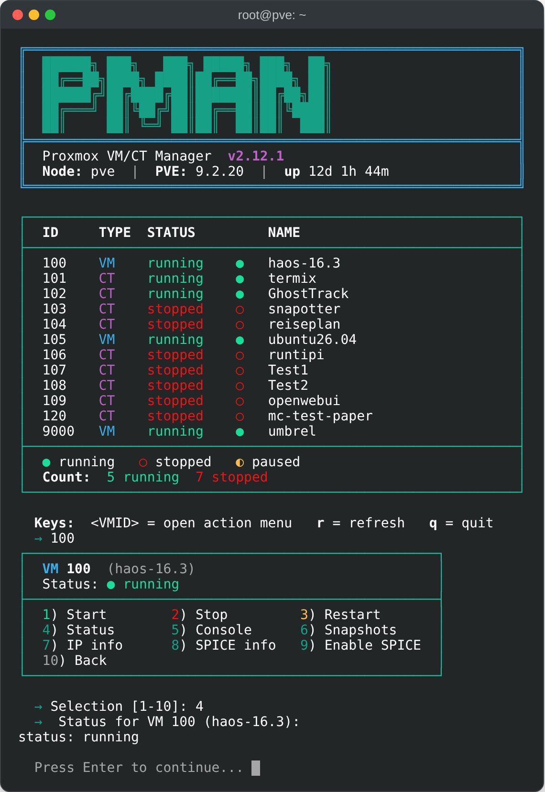
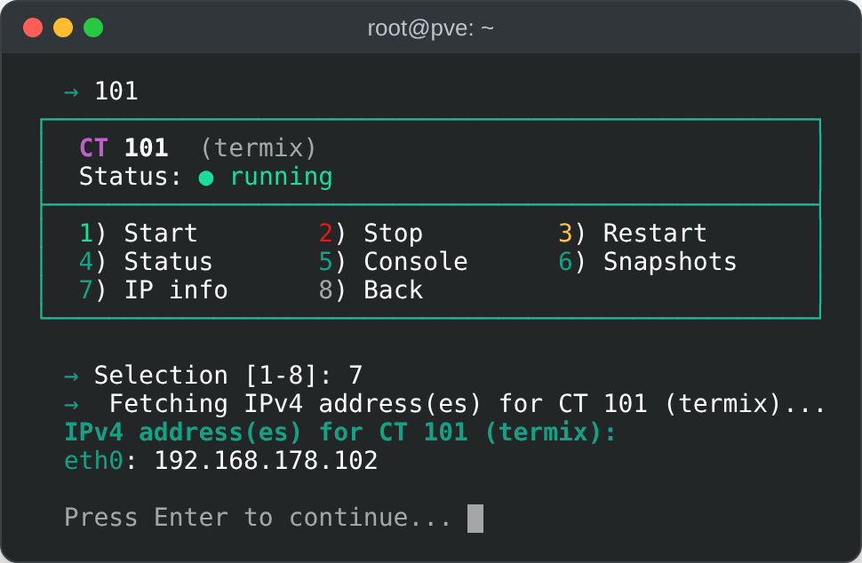
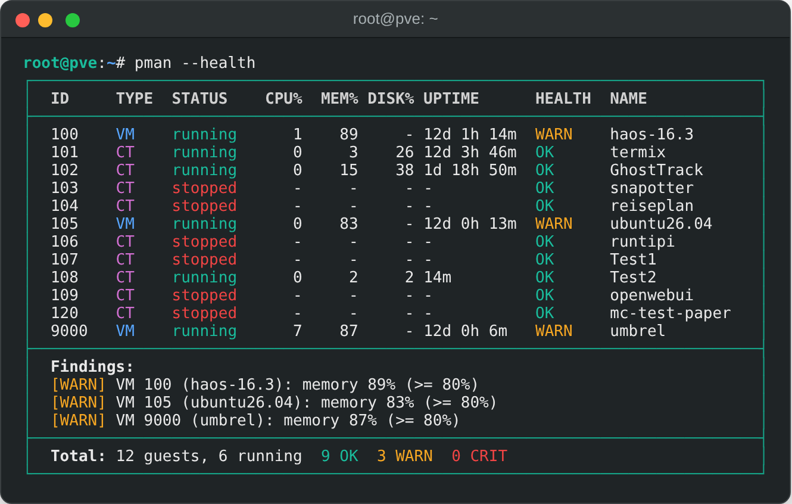
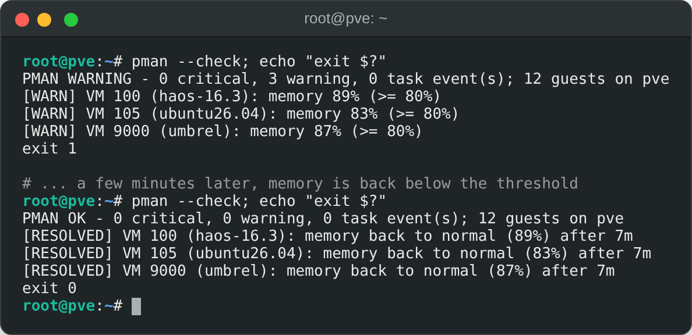
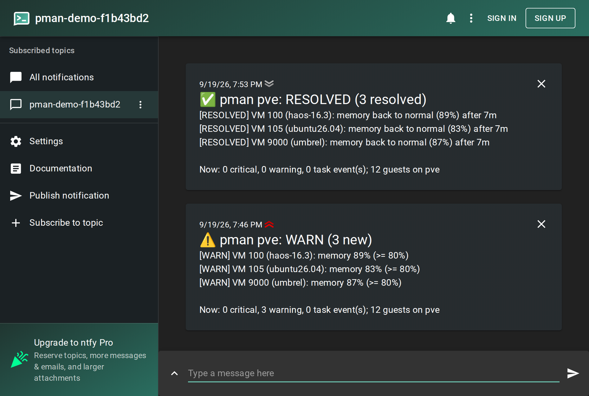
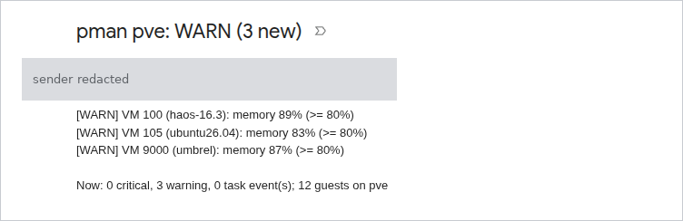
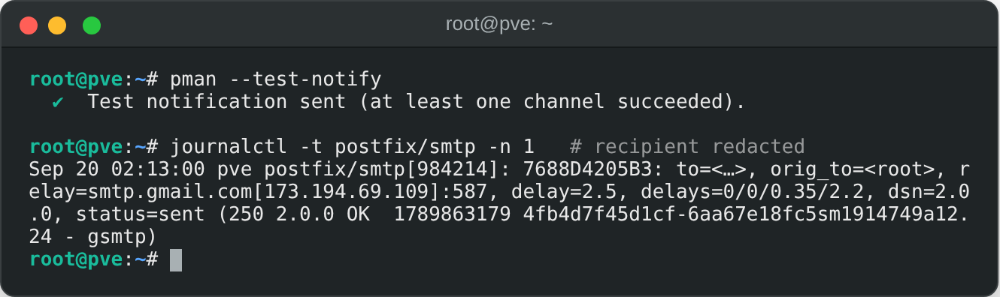
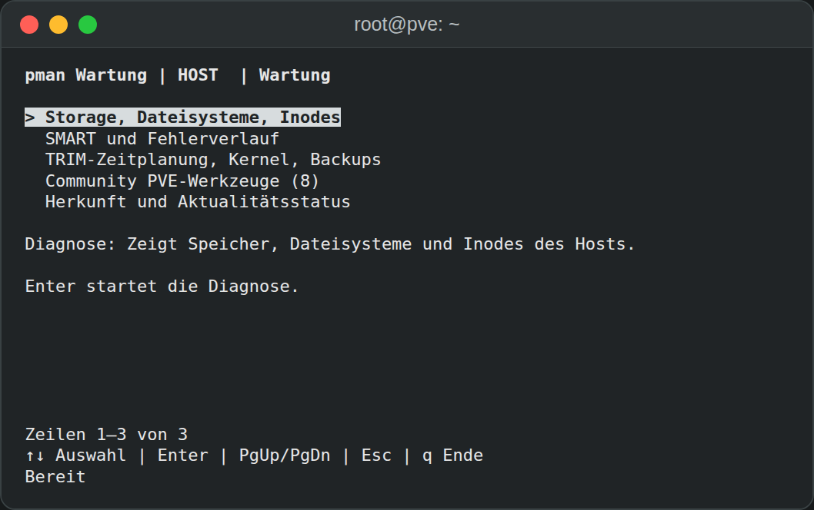

# Proxmox Manager

Manage Proxmox VE virtual machines and LXC containers from the terminal.

Proxmox Manager (`pman`) provides interactive guest management, scriptable
inventory output and health checks on the local Proxmox node. Its Bash core
uses the tools included with Proxmox VE and runs on demand. An optional Python
module adds storage diagnostics and host maintenance.

[](https://github.com/TimInTech/proxmox-manager/actions/workflows/ci.yml)
[](https://github.com/TimInTech/proxmox-manager/actions/workflows/gitleaks.yml)
[](LICENSE)

English · [Deutsch](README.de.md)


Read-only recording: inventory, health, host maintenance and a community-script
confirmation with source preview. No maintenance changes are executed.
[Local interactive player](docs/demo/index.html) ·
[Recording details](docs/demo/README.md). To use the player, open the HTML file
from a local checkout; GitHub displays its source.

[Installation](#installation) · [Usage](#usage) ·
[Health & alerts](#health-monitoring--alerts) ·
[Configuration](#configuration) · [Maintenance](#optional-maintenance)

## Features

- **Guest management.** List VMs and containers; start, shut down and restart
  guests; open consoles; look up IPv4 addresses; manage snapshots.
- **Health monitoring.** CPU, memory, disk usage and uptime per guest, with
  configurable thresholds and alerts through ntfy or e-mail.
- **Automation.** Plain-text and JSON inventory, status and name filters,
  Nagios-style check exit codes and optional structured logs.
- **SPICE access.** Configure a QXL display and request authenticated `.vv`
  connection files through the Proxmox proxy.
- **Optional maintenance.** Storage, filesystem and SMART diagnostics, scoped
  guest maintenance and selected Proxmox VE Helper-Scripts from the community.

## Installation

Run as **root on the Proxmox VE node**. The project targets PVE 7.x, 8.x and
9.x. The core requires Bash 4 or newer, `qm`, `pct`, `pvesh` and Python 3,
which are included with PVE. The clone instructions also require Git.

```bash
git clone https://github.com/TimInTech/proxmox-manager.git
cd proxmox-manager
./install_dependencies.sh --without-maintenance
pman
```

The installer places an atomic, root-owned copy at `/usr/local/bin/pman`.
Subsequent edits to the checkout do not change the installed executable. It
installs no APT packages, optional viewers or development tools.

To run the core directly from the checkout:

```bash
bash proxmox-manager.sh
```

### Add the maintenance module

The module requires Python 3.9 or newer with `curses` and a UTF-8 terminal.
It uses only the Python standard library.

```bash
./install_dependencies.sh --with-maintenance --lang en
pman --maintenance
```

Without `--with-maintenance` or `--without-maintenance`, the installer asks in
an interactive terminal; without a terminal it installs only the core.
The maintenance interface supports German (default) and English. When neither
module flag is passed, the first interactive installation also asks for the
language. `--lang de|en` sets it explicitly in `/etc/pman/language`; upgrades
preserve the choice.
`PMAN_LANG=en pman --maintenance` overrides it for one run.

Installing the module normally enables a daily systemd timer for public source
metadata checks. Add `--no-source-timer` to install without enabling it, or
turn it off later:

```bash
systemctl disable --now pman-maintenance-sources.timer
```

See [optional maintenance](#optional-maintenance) for controls, source
verification, rollback and removal.

## Usage

### Interactive management

Run `pman`, then enter a guest's VMID to open its action menu. Press `h` for
health, `r` to refresh and `q` to quit. `M` or `m` opens optional maintenance
for the host from the main menu, or for the selected guest from its action menu.

```text
[+] running   [-] stopped   [~] paused   [?] unknown
```

| Guest inventory | Guest actions |
| --- | --- |
|  |  |

Screenshots are example views; version labels and output may differ from the
current checkout.

Stop requests a graceful shutdown with `qm shutdown` or `pct shutdown`. Proxmox
force-stops the guest only after the configured timeout (60 seconds by default).
Destructive core actions request confirmation; errors include Proxmox details.
Snapshot rollback and deletion show the selected snapshot before confirmation.

Container consoles use `pct enter`; VM consoles use `qm terminal` and require
a configured serial console, with `qm monitor` as a fallback. Both require a
running guest. IPv4 lookup uses `pct exec` for containers and the QEMU Guest
Agent for VMs.

### Command reference

| Command | Purpose |
| --- | --- |
| `pman` | Open the interactive guest table and action menus. |
| `pman --list` | Print a plain-text inventory. |
| `pman --json` | Print inventory as a JSON array. |
| `pman --list --filter running` | Filter by `running`, `stopped` or `paused`. |
| `pman --list --name 'web\|db'` | Filter names with an extended regular expression; combines with `--filter`. |
| `pman --health` | Show local guest health; combines with `--list` or `--json`, and with name/status filters. |
| `pman --check` | Check health and notify on changes; exit `0` OK, `1` WARN, `2` CRIT, `3` UNKNOWN. |
| `pman --check --dry-run` | Print the result and proposed notification without sending or saving state. |
| `pman --test-notify` | Send a test message through every configured notification channel. |
| `pman --maintenance` | Open the optional host maintenance interface. |
| `pman --timeout 30` | Set seconds before a shutdown is force-stopped. |
| `pman --force` | Skip supported core confirmations; maintenance confirmations remain mandatory. |
| `pman --no-clear` | Preserve terminal contents between interactive views. |
| `pman --once` | Run one interactive refresh cycle, for example when recording. |
| `pman --version` | Print the core version. |
| `pman --help` | Show help; `-h` is equivalent. |

`--list` and `--json` are alternative output modes. `--check` always checks all
local guests and does not accept name/status filters or other output modes.
`--maintenance` also runs separately from inventory and health modes.

### JSON inventory

```bash
pman --json
```

Example output:

```json
[
  {"id": 100, "type": "VM", "status": "running", "symbol": "[+]", "name": "web-server"},
  {"id": 101, "type": "CT", "status": "stopped", "symbol": "[-]", "name": "db-container"}
]
```

Use the built-in filter to keep the array, or install `jq` separately to
transform the data:

```bash
pman --json --filter running
pman --json | jq '.[] | select(.status == "running")'
```

An inventory query failure produces a nonzero exit status rather than a
successful empty or partial result.

### SPICE remote desktop

For a running VM with a QXL display, **SPICE info** requests an authenticated
`.vv` connection file from the Proxmox `spiceproxy` API using `pvesh` and Python
3. If `remote-viewer` is installed and a graphical session is available, pman
launches it automatically. On Debian, the viewer package is installed with:

```bash
apt install virt-viewer
```

Otherwise, pman prints the private connection file's path. Open it promptly
with `remote-viewer` on a desktop that can reach the Proxmox proxy on TCP 3128.
The file contains a short-lived ticket and TLS trust information; delete unused
files. `PROXMOX_MANAGER_SPICE_ADDR` selects the client-reachable proxy hostname
or IP, not the VM's bind address.

**Enable SPICE** sets the VGA type to QXL while preserving named VGA properties
and existing QXL multi-monitor settings. Applying a display hardware change
requires a full shutdown and start; pman does not restart the VM automatically.

## Health monitoring & alerts

`pman --health` shows CPU, memory, disk usage, uptime and health levels for
guests
on the **local node**, excluding templates. Add `--list` for plain text or
`--json` for machine-readable data, with `null` for unavailable values.
The same data appears under `h` and in the guest status action.



### Set up notifications

Run these steps as root after installing `pman`.

1. Configure at least one channel in a private `/etc/pmanrc`. Replace the topic
   below with your own hard-to-guess name; anyone who knows a public ntfy topic
   can read it. For access control, use a protected topic and a token file as
   described under [notification channels](#notification-channels).

   ```bash
   touch /etc/pmanrc
   chmod 600 /etc/pmanrc
   cat >>/etc/pmanrc <<'EOF'
   NTFY_URL="https://ntfy.sh/pman-alerts-CHANGE-ME"
   # HEALTH_MAIL_TO="admin@example.com"
   EOF
   ```

2. Subscribe to the topic in the [ntfy app](https://ntfy.sh/docs/subscribe/phone/)
   or at `https://ntfy.sh/<your-topic>`, then test delivery and inspect a dry run.
   Enable e-mail only after local `sendmail` delivery works: the test uses every
   configured channel; it succeeds if at least one delivers and warns about
   failed channels.

   ```bash
   pman --test-notify
   pman --check --dry-run; echo "exit $?"
   ```

3. Schedule a check every five minutes. Cron needs an explicit `PATH` that
   includes `/usr/sbin`.

   ```bash
   cat >/etc/cron.d/pman-health <<'EOF'
   PATH=/usr/sbin:/usr/bin:/sbin:/bin
   */5 * * * * root /usr/local/bin/pman --check >/dev/null 2>&1
   EOF
   ```

The first run establishes a baseline for task history; existing guest health
problems can already trigger alerts. Later runs notify on new or escalated
problems, improvements and `RESOLVED`, including duration. Each run combines
its changes into one message.

### Checks and thresholds

| Check | Level | Behaviour |
| --- | --- | --- |
| CPU | WARN / CRIT | Requires `HEALTH_CPU_RUNS` consecutive runs before the initial alert. |
| Memory, disk | WARN / CRIT | Immediate; VM disk usage requires the QEMU Guest Agent. |
| Guest stops | — | Clears its CPU, memory and disk alerts. |
| Stopped with `onboot=1` | CRIT | WARN if a Proxmox task explains the stop. |
| Unexpected stop | WARN | Previously running, without an explaining stop, shutdown, suspend, migrate, destroy or backup task. |
| Failed node task | WARN / CRIT | Completed unsuccessfully since the last check; `WARNINGS` yields WARN. |

Thresholds are percentages; `0` disables the respective level.

| Setting | Default | Setting | Default |
| --- | --- | --- | --- |
| `HEALTH_CPU_WARN` | 85 | `HEALTH_CPU_CRIT` | 95 |
| `HEALTH_MEM_WARN` | 90 | `HEALTH_MEM_CRIT` | 95 |
| `HEALTH_DISK_WARN` | 85 | `HEALTH_DISK_CRIT` | 95 |
| `HEALTH_CPU_RUNS` | 3 | `HEALTH_IGNORE_IDS` | Empty; e.g. `105,210` |

State is stored in `HEALTH_STATE_DIR` (default `/var/lib/pman`, mode `0700`).
If every configured channel fails, unsent changes remain pending for the next
run. Output is a Nagios-style summary followed by one line per problem. Exit
codes are `0` OK, `1` WARN, `2` CRIT and `3` UNKNOWN; usage, configuration,
locking and `pvesh` errors produce UNKNOWN in check mode.



A shutdown initiated inside a guest has no Proxmox task and is reported as an
unexpected stop. In a cluster, schedule checks on every node; each checks only
its local guests. Failed-task detection examines the last 200 node tasks.

### Notification channels

For public or self-hosted [ntfy](https://ntfy.sh), set `NTFY_URL`. Protected
topics can use `NTFY_TOKEN_FILE`; keep the token out of `pmanrc`:

```bash
# /etc/pmanrc
NTFY_URL="https://ntfy.sh/pman-alerts-CHANGE-ME"
NTFY_TOKEN_FILE="/etc/pman/ntfy.token"
```

Create a private token file, then enter the token in the editor:

```bash
install -d -m 700 /etc/pman
install -m 600 /dev/null /etc/pman/ntfy.token
nano /etc/pman/ntfy.token
```

The token file and its directory must not be writable by others. Token
authentication requires HTTPS; an HTTP URL with a token is a configuration
error.

E-mail uses local `sendmail`, for example Postfix with working relay delivery.
Recipients are comma-separated without spaces; the sender is optional:

```bash
# /etc/pmanrc
HEALTH_MAIL_TO="admin@example.com"
HEALTH_MAIL_FROM="pman@pve.example.com"
```

Both channels use the same message text. E-mail is plain text and carries
`Auto-Submitted: auto-generated`.

| ntfy notification | E-mail notification |
| --- | --- |
|  |  |

### Relaying through an external SMTP provider

Hosts without direct mail delivery need a smarthost, for example when port 25
is blocked or a dynamic IP is rejected. This recipe configures Postfix for Gmail
submission on port 587; other providers may require different authentication,
sender policies and endpoints. Use your actual account instead of
`you@example.com`. Gmail app passwords depend on account eligibility; see
[Google's app-password instructions](https://support.google.com/accounts/answer/185833).

Install SASL support and enter the app password without spaces. The password is
read interactively so it does not become part of shell history:

```bash
apt install libsasl2-modules
umask 077
read -rsp "app password: " PMAN_SMTP_PASSWORD; echo
printf '[smtp.gmail.com]:587 you@example.com:%s\n' "$PMAN_SMTP_PASSWORD" >/etc/postfix/sasl_passwd
unset PMAN_SMTP_PASSWORD
postmap /etc/postfix/sasl_passwd
chmod 600 /etc/postfix/sasl_passwd /etc/postfix/sasl_passwd.db
```

Configure encrypted submission and rewrite the envelope sender to the
authenticated account:

```bash
postconf -e "relayhost = [smtp.gmail.com]:587" \
  "smtp_sasl_auth_enable = yes" \
  "smtp_sasl_password_maps = hash:/etc/postfix/sasl_passwd" \
  "smtp_sasl_security_options = noanonymous" \
  "smtp_sasl_tls_security_options = noanonymous" \
  "smtp_tls_security_level = encrypt" \
  "smtp_tls_CAfile = /etc/ssl/certs/ca-certificates.crt" \
  "sender_canonical_classes = envelope_sender" \
  "sender_canonical_maps = regexp:/etc/postfix/sender_canonical"
echo '/.+/  you@example.com' >/etc/postfix/sender_canonical
echo 'root: you@example.com' >>/etc/aliases
newaliases
systemctl restart postfix
```

The root alias also routes Proxmox's own root notifications to that mailbox.
If IPv6 delivery fails with `Network is unreachable`, configure
`postconf -e "inet_protocols = ipv4"` and restart Postfix. Check delivery:

```bash
pman --test-notify
journalctl -t postfix/smtp -n 5 --no-pager
mailq
```

Look for `status=sent` and an empty queue. On systems without
`/var/log/mail.log`,
use the journal. Errors `535 5.7.8` or `534 5.7.9` indicate an authentication
problem; check the app password and account requirements. Gmail may rewrite the
From address; filter by subject or use a recipient such as
`you+pman@example.com`.



## Configuration

Settings are loaded in this order: environment/defaults, `/etc/pmanrc`,
`~/.pmanrc`, then CLI flags. Later values take precedence.

```bash
# ~/.pmanrc
STOP_TIMEOUT=120
LOG_FILE="/var/log/proxmox-manager.log"
PROXMOX_MANAGER_SPICE_ADDR="spice.example.invalid"
HEALTH_MEM_WARN=80
NTFY_URL="https://ntfy.sh/pman-alerts-CHANGE-ME"
```

Files are parsed as data, never sourced as shell code. Accepted keys:

| Group | Keys |
| --- | --- |
| Core | `STOP_TIMEOUT`, `LOG_FILE`, `PROXMOX_MANAGER_SPICE_ADDR` |
| Thresholds | `HEALTH_CPU_WARN`, `HEALTH_CPU_CRIT`, `HEALTH_MEM_WARN`, `HEALTH_MEM_CRIT`, `HEALTH_DISK_WARN`, `HEALTH_DISK_CRIT` |
| Check state | `HEALTH_CPU_RUNS`, `HEALTH_IGNORE_IDS`, `HEALTH_STATE_DIR` |
| Notifications | `NTFY_URL`, `NTFY_TOKEN_FILE`, `HEALTH_MAIL_TO`, `HEALTH_MAIL_FROM` |

Unknown keys produce a warning and are ignored. Health settings are validated
by `--health`, `--check` and `--test-notify`, so mistakes in those settings do
not block the guest-management interface. Keep files private, for example
`chmod 600 /etc/pmanrc`.

Logging is disabled when `LOG_FILE` is empty. If enabled, the path must be
absolute and refer to a non-symlink regular file owned by the current user,
mode `0600`. The parent directory must also be owner-controlled and not writable
by group or others. Full Proxmox error output goes to the log; terminal errors
show the first line.

### Shell completions

```bash
# Bash, system-wide
cp completions/pman.bash /etc/bash_completion.d/pman

# Zsh
mkdir -p ~/.zsh/completions
cp completions/pman.zsh ~/.zsh/completions/_pman
```

For Zsh, include `~/.zsh/completions` in `fpath` before calling `compinit`.

## Optional maintenance

The maintenance interface provides host storage, filesystem and SMART
information. Guest diagnostics and changes are scoped to the selected VM or
container, including confirmed TRIM and APT cache cleanup for Debian/Ubuntu
containers. Native guest actions never start stopped guests. Every change
requires confirmation, which `--force` cannot bypass.



Arrow keys select an action; Enter opens it. Page Up/Down scrolls output,
Esc returns or cancels a confirmation, and `q` exits. `Tab` switches the CT scan
directory. Display adapts to the terminal size:

| Environment variable | Effect |
| --- | --- |
| `NO_COLOR=1` | Disable colour. |
| `PMAN_ASCII=1` | Use ASCII box and arrow characters; automatic on `TERM=linux`. |
| `PMAN_HYPERLINKS=1` or `0` | Force OSC 8 links on or off; URLs also appear as plain text. |
| `PMAN_LANG=en` or `de` | Override the installed maintenance language for one run. |

### Community helper scripts

The host menu includes eight selected **Proxmox VE Helper-Scripts (Community)**
from [community-scripts/ProxmoxVE](https://github.com/community-scripts/ProxmoxVE)
([project website](https://community-scripts.org), MIT license). This is
third-party code, maintained separately from pman and Proxmox. Helpers have
their own interactive dialogs and may change the host or guests selected within
the helper.

Tools are grouped by intent and labelled `[READ]`, `[CHANGE]` or `[DELETE]`
in English (`[LESEN]`, `[ÄNDERT]`, `[LÖSCHT]` in German). Disk Health may also
install packages after its own prompt. Deletion has no recycle bin.

Before confirmation, pman checks the live upstream source and downloads the
pinned revision. The confirmation shows the source URL, command, root execution
notice, revision and checksum. Press `v` to inspect the verified script; `j`
launches those exact bytes. Verification runs again immediately before launch.
Changed, missing or unreachable sources block execution, with the file and
reviewed/current revisions named in the message. The optional upstream telemetry
component is omitted.

A cancelled CT scan may continue in the guest until its 55-second timeout.
Source checks and downloads can block the interface for about a minute while
network timeouts expire. Cancelling a running change does not roll it back.
See the [maintenance documentation](docs/maintenance.md) for scope, source
checks
and operational limits.

### Rollback and removal

From a checkout, switch to the previous installed module release or remove
only the optional module:

```bash
./install_dependencies.sh --rollback-maintenance
```

```bash
./install_dependencies.sh --uninstall-maintenance
```

Both retain the Bash core. Removal also retains health cron configuration and
private diagnostic state.

## Security

The core runs as root using the host's Proxmox authentication; it needs no
separate Proxmox API credentials or pman daemon. Guest agents are required for
specific metrics and VM IP lookup, not for basic inventory and management.

Notifications are opt-in. Maintenance can contact public source services,
download pinned helpers and run its daily metadata timer. ntfy tokens are read
from private files, passed to `curl` through stdin and require HTTPS. SPICE
connection files contain temporary authentication tickets.

CI includes ShellCheck, mock tests and Gitleaks scanning. Report vulnerabilities
according to [SECURITY.md](SECURITY.md).

## Community & Tutorials

External articles about the project; commands and screenshots may describe
older versions.

- [Proxmox Manager – Co to jest, jak działa, instalacja i obsługa](https://blog.askomputer.pl/proxmox-manager-timintech-co-to-jest-jak-dziala-instalacja-i-obsluga/)
  — askomputer.pl. Polish installation and usage walkthrough with screenshots.
- [Stop Wrestling Proxmox GUIs: Meet the Single-Bash TUI That Changes Everything](https://prompts.brightcoding.dev/blog/stop-wrestling-proxmox-guis-meet-the-single-bash-tui-that-changes-everything)
  — Bright Coding. English overview of installation and guest management.
- [This Lightweight Proxmox Tool Makes CLI Management Faster](https://www.virtualizationhowto.com/2026/05/this-lightweight-proxmox-tool-makes-cli-management-faster/)
  — Brandon Lee, Virtualization Howto. English review covering VM/LXC
management,
  snapshots, consoles and homelab use.

## Development

Local tests use mocks and require neither a Proxmox host nor live guest actions:

```bash
shellcheck proxmox-manager.sh
bash tests/run.sh
bash tests/test_inventory.sh
bash tests/test_spice.sh
python3 -B -m unittest discover -s tests/maintenance -v
```

They cover CLI parsing, configuration, inventory, snapshots, SPICE, health
checks, notifications and the optional maintenance module. Install development
tools separately. Follow [CONTRIBUTING.md](CONTRIBUTING.md) for style, testing
and
pull requests, and the [Code of Conduct](CODE_OF_CONDUCT.md). Keep runtime
dependencies limited to the host tools and Python standard library; do not
commit generated reports or large test artifacts.

Use [issues](https://github.com/TimInTech/proxmox-manager/issues) for bug reports
and feature discussions. Release history and the unreleased 2.14.1 changes
present in this checkout are documented in [CHANGELOG.md](CHANGELOG.md).

## License

[MIT](LICENSE). Maintained by [TimInTech](https://github.com/TimInTech).
[Support the project](https://buymeacoffee.com/timintech).
